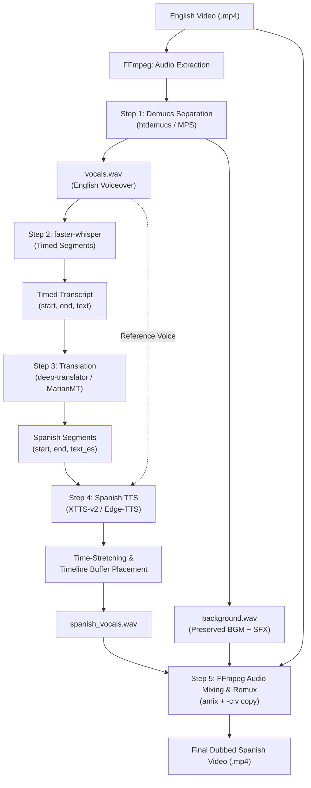

# 🎙️ ManhwaDub: Local AI Video Dubbing Studio for Apple Silicon

A high-performance, local AI pipeline optimized for **Apple Silicon (M1 Pro/Max, M2, M3, M4)**. Designed specifically to dub English **"Manhwa recap / motion comic"** videos into Spanish while preserving the original background music (BGM) and sound effects (SFX) with zero re-encoding loss.

Includes both an **interactive Gradio Web UI** and a **headless CLI automation script**.

---

## ⚡ Apple Silicon Optimization Highlights

1. **GPU Acceleration (`device = "mps"`)**:
   - Utilizes PyTorch Metal Performance Shaders for model inference.
   - Automatically activates `PYTORCH_ENABLE_MPS_FALLBACK=1` to guarantee zero crashes if an unsupported operator is encountered on MPS.
2. **CPU Acceleration for Speech-to-Text**:
   - `faster-whisper` (CTranslate2) runs natively on Apple Silicon arm64 using Apple's Accelerate framework and NEON vector extensions (`compute_type="int8"`). This executes transcription at **15x-20x real-time speed** on M1 Pro/Max performance cores.
3. **Zero-Loss Video Remuxing**:
   - Video streams are passed through untouched via FFmpeg `-c:v copy`, ensuring zero visual quality degradation and near-instant export.
4. **Dynamic Time-Stretching Speech Sync**:
   - Spanish translations typically contain 15-25% more syllables than English. The pipeline dynamically time-stretches speech chunks to sync with original comic panels without pitch distortion.

---

## 🏗️ 5-Step Pipeline Architecture



---

## 🚀 Quick Start Guide

### 1. Prerequisites (macOS Terminal)

Ensure Homebrew and FFmpeg are installed:
```bash
brew install ffmpeg python@3.11
```

### 2. Automatic Setup

Run the setup script to initialize the virtual environment and install all packages:
```bash
./setup_env.sh
```

Or manually:
```bash
python3.11 -m venv venv
source venv/bin/activate
pip install --upgrade pip
pip install -r requirements.txt
```

---

## ⚛️ Modern React.js Web UI (with YouTube Link Downloader)

A sleek, dark-mode **React.js Frontend** has been created with support for:
- 🔗 **Direct YouTube link input**: Paste any motion comic or recap YouTube link — it is downloaded automatically via `yt-dlp` and dubbed locally.
- 📁 **Drag & drop local video upload**: Supports `.mp4`, `.mov`, `.mkv`.
- 🌐 **Instant Language Selector**: Switch between **Spanish, Tamil, Telugu, Bengali, Hindi, Kannada, Malayalam, Marathi**.
- 🎙️ **Narrator Voice Picker**: Select regional voice styles (dramatic, energetic, storytelling).
- 📊 **Real-time Live Progress Bar & Console Logs**: Streams progress via WebSocket/REST.
- 🎬 **Dubbed Video Player & Download**: Watch your dubbed video directly with background music preserved!
- 🎧 **Audio Stem Player**: Inspect original audio, isolated vocals, and background music individually.

### Running the React Frontend:
The React frontend is automatically served directly by FastAPI without any extra setup:
```bash
source venv/bin/activate
python api.py
```
Then open your browser at:
👉 **`http://127.0.0.1:8000/`** (or `http://127.0.0.1:8000/app`)

*(Full Vite + React source code is also available in the [`frontend/`](file:///Users/bspl-mac-m1-pro/Music/PP/mve/frontend) folder for developers who want to run `npm run dev` separately).*

---

## 🖥️ Alternative Gradio Studio (Python-only)

If you prefer the Gradio interface:
```bash
source venv/bin/activate
python app.py
```
Open **`http://localhost:7860`**.

## ⚡ Running the FastAPI REST API Backend

For programmatic integrations, microservices, mobile apps, or custom web frontends:
```bash
source venv/bin/activate
python api.py
# or: python main.py --api
```
- **Swagger Interactive Docs**: [http://127.0.0.1:8000/docs](http://127.0.0.1:8000/docs)
- **Redoc Documentation**: [http://127.0.0.1:8000/redoc](http://127.0.0.1:8000/redoc)
- **Hardware Health Endpoint**: [http://127.0.0.1:8000/api/health](http://127.0.0.1:8000/api/health)

### Key REST Endpoints:
- `POST /api/dub`: Submit video file + target language (`es`, `ta`, `te`, `bn`, `hi`) -> returns `job_id`.
- `GET /api/jobs/{job_id}`: Poll real-time progress percentage (0.0 to 1.0) and terminal logs.
- `GET /api/jobs/{job_id}/video`: Stream/download finalized dubbed MP4 video.
- `GET /api/jobs/{job_id}/segments`: Fetch JSON subtitles with translated text & timestamps.
- `GET /api/jobs/{job_id}/audio/{stem}`: Stream isolated `vocals`, `background`, or `spanish_vocals`.
- `WS /api/jobs/{job_id}/ws`: Stream live progress over WebSockets.

---

## 💻 Running the Headless CLI

For automated batch processing or script integration:
```bash
source venv/bin/activate

# Basic run
python main.py -i input_video.mp4 -o output_dubbed.mp4

# Advanced configuration
python main.py \
  --input "manhwa_ch1_recap.mp4" \
  --output "manhwa_ch1_recap_es.mp4" \
  --whisper-model "small" \
  --translator "deep-translator" \
  --voice "es-ES-AlvaroNeural" \
  --bg-volume 0.75 \
  --vocals-volume 1.05
```

### CLI Arguments Reference

| Flag | Default | Description |
| :--- | :--- | :--- |
| `-i, --input` | *Required* | Path to input English `.mp4` video |
| `-o, --output` | `None` | Path to destination Spanish `.mp4` video |
| `--whisper-model` | `base` | Whisper model size (`tiny`, `base`, `small`, `medium`) |
| `--translator` | `deep-translator` | `deep-translator` (fast online) or `helsinki-nlp` (offline) |
| `--tts-engine` | `edge-tts` | `edge-tts` (neural narrator) or `xtts` (voice cloning) |
| `--voice` | `es-ES-AlvaroNeural` | Spanish narrator voice |
| `--voice-clone` | `False` | Toggle zero-shot voice cloning using original English vocals |
| `--bg-volume` | `0.80` | Background music & SFX volume ducking level |
| `--vocals-volume` | `1.00` | Spanish vocals volume level |
| `--ui` | `False` | Launch Gradio Web UI directly |
